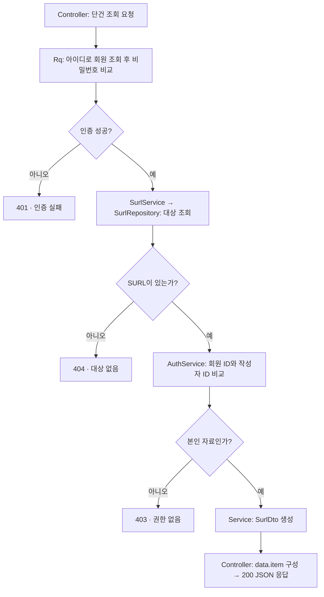
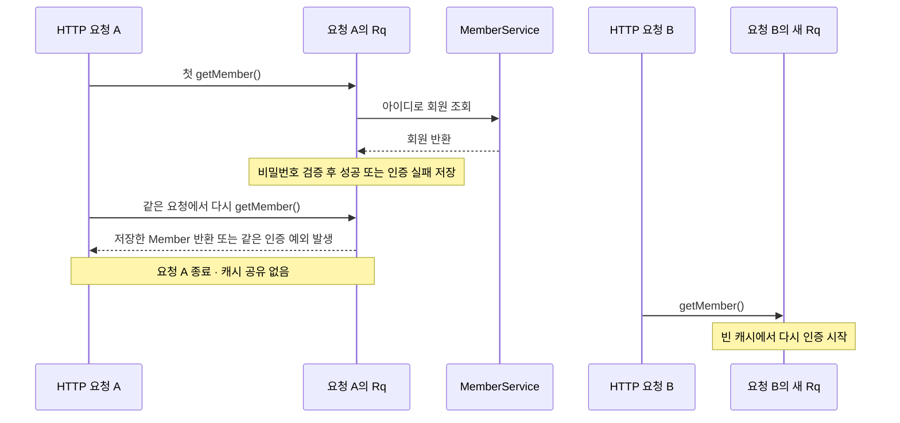

# 2학기 8주차 — 아이디/비밀번호를 포함시킨 인증

7주차에는 회원가입 요청을 받아 회원을 DB에 저장했다.<br>
이번에는 저장한 아이디와 비밀번호로 요청한 회원을 확인하고, 본인이 만든 단축 URL만 관리하도록 연결했다.

학습 범위: **Chapter 09, 09-01~09-15** (강의 PDF 137~146쪽)<br>
단계별 구현 내용은 [Chapter 09 구현 기록](./docs/chapter09-progress.md)에 정리했다.

## 이번 주 한눈에 보기

| 구분 | 내용 |
| --- | --- |
| 환경 | Java 21 / Spring Boot 3.2.4 / Gradle 8.6 |
| 구현 기능 | SURL 등록·단건 조회·목록·수정·삭제 |
| 인증 | 매 요청의 actorUsername·actorPassword로 회원 확인 |
| 인가 | 작성자만 단건 조회·수정·삭제, 목록은 본인 자료만 반환 |
| 요청별 캐싱 | 같은 요청 안에서 인증 성공·실패 결과 재사용 |
| 검증 기록 | 총 85개 통과, 실패·오류·스킵 0개 |

## 회원가입에서 인증·인가로

| 단계 | 확인하는 것 | 담당 |
| --- | --- | --- |
| 7주차 · 회원가입 | 아이디·비밀번호를 받아 회원 저장 | MemberService |
| 8주차 · 인증 | 이 요청을 보낸 사람이 누구인가? | Rq |
| 8주차 · 인가 | 이 회원이 해당 SURL의 작성자인가? | AuthService |

기존 `POST /api/v1/members`와 `/join`은 유지했다.
가입한 회원의 아이디·비밀번호를 매 요청에 보내고, 확인된 회원을 작성자로 사용한다.
**비밀번호가 맞아도 다른 회원의 자료는 관리할 수 없다.**

## 요청부터 응답까지

`GET /api/v1/surls/{id}` 단건 조회 흐름이다. 위에서 아래로 읽으면 된다.



Rq의 회원 조회는 `MemberService → MemberRepository`를 거친다.
SURL은 **대상 조회 → 권한 검사 → DTO 변환** 순서이며, DB 작업은 서비스 트랜잭션 안에서 처리한다.
응답의 HTTP 상태는 ResponseAspect가 반영한다.

| 작업 | 처리 방식 |
| --- | --- |
| 등록 | 인증한 회원을 작성자로 저장 |
| 목록 | 본인 자료만 ID 역순으로 조회 |
| 단건 조회·수정·삭제 | 대상을 찾고 AuthService로 소유권 검사 |
| 공유 링크 `/g/{id}` | 인증 없이 원본 URL로 이동·조회수 증가 |

핵심 코드: [Controller](./src/main/java/com/ll/demo03/ApiV1SurlController.java) · [Rq](./src/main/java/com/ll/demo03/global/rq/Rq.java) · [Service](./src/main/java/com/ll/demo03/SurlService.java) · [AuthService](./src/main/java/com/ll/demo03/AuthService.java)

## Rq에서 아이디·비밀번호 확인하기

Rq는 `@RequestScope` 빈이다. 같은 HTTP 요청에서는 같은 객체를 사용하고, 다음 요청에서는 새 객체를 사용한다.
아래는 `getMember()`의 핵심 부분이다. 파라미터 추출·필수값 검사와 실패 캐시 처리 등은 생략했다.

```java
if (member != null) return member;
if (authenticationFailure != null) throw authenticationFailure;

// actorUsername·actorPassword를 읽고 필수값을 검사한 뒤 실행
Member candidate = memberService.findByUsername(username)
        .orElseThrow(() -> new GlobalException("401-3", "인증정보가 올바르지 않습니다."));
if (!password.equals(candidate.getPassword()))
    throw new GlobalException("401-4", "인증정보가 올바르지 않습니다.");
member = candidate;
return member;
```

비밀번호까지 일치한 회원만 성공 캐시에 넣는다.
인증정보 누락·없는 회원·비밀번호 불일치도 실패로 캐시하지만, DB 장애 같은 일반 예외는 캐시하지 않는다.

### 캐시는 어디까지 유지될까?



**같은 요청에서는 중복 조회를 줄이고, 다음 요청에서는 다시 인증한다.**
RequestScope 캐시는 로그인 상태를 유지하는 세션이 아니다.

## 응답과 DB 처리에서 달라진 점

| 개념 | 이번 코드에서 적용한 방식 |
| --- | --- |
| DTO | SurlDto에 공개할 값만 복사. Member 객체·비밀번호 제외 |
| OSIV 끄기 | 서비스 밖에서 추가 DB 조회가 필요 없도록 트랜잭션 안에서 DTO 완성 |
| 트랜잭션 | 조회는 읽기 전용, 등록·수정·삭제·조회수 증가는 쓰기 작업으로 처리 |
| Dirty Checking | 관리 중인 엔티티의 값을 바꿔 수정 반영. save 재호출 없이 flush 후 응답 |

SurlDto에는 ID·생성일·수정일·작성자 ID·nickname·설명·URL·조회수가 담긴다.
`spring.jpa.open-in-view=false`를 사용하며, 강의의 Controller 트랜잭션 대신 기존 서비스 계층 구조를 유지했다.

## API 요청·응답

기본 포트는 `8090`이다. 인증정보는 JSON 본문이 아닌 쿼리 파라미터로 보낸다.
등록·수정 본문에는 `body`와 `url`을 넣는다.

| 메서드 | 경로 | 기능 |
| --- | --- | --- |
| POST | `/api/v1/members` | 회원가입, 인증 불필요 |
| POST | `/api/v1/surls` | SURL 등록 |
| GET | `/api/v1/surls/{id}` | 본인 SURL 단건 조회 |
| GET | `/api/v1/surls` | 본인 SURL 목록 |
| PUT | `/api/v1/surls/{id}` | 본인 SURL 수정 |
| DELETE | `/api/v1/surls/{id}` | 본인 SURL 삭제 |

SURL API의 정상 응답은 200이며, 회원가입은 기존처럼 201이다.
단건·등록·수정 결과는 `data.item`, 목록은 `data.items`에 담는다.

### 정상 요청: 본인 목록 조회

아래 계정은 초기 데이터의 로컬 학습용 예시다.
해당 회원이 아직 SURL을 등록하지 않았다면 빈 목록을 반환한다.

```http
GET /api/v1/surls?actorUsername=user1&actorPassword=1234
```

```json
{"resultCode":"200-1","statusCode":200,"msg":"성공","data":{"items":[]}}
```

### 오류 요청: 비밀번호 누락

```http
GET /api/v1/surls?actorUsername=user1
```

```json
{"resultCode":"401-2","statusCode":401,"msg":"인증정보(비밀번호)를 입력해주세요.","data":{}}
```

### 기존 경로도 함께 확인

`GET /add`, `GET /s/{body}/**`, `GET /all`에도 같은 인증 정책을 적용했다.
`/s/**`는 원본 검색어를 보존하되, 인코딩된 이름을 포함한 인증 파라미터를 제거해 저장·응답·이동 URL로 넘기지 않는다.
기존 GET 등록은 호환 학습용 경로이며, 새 코드에서는 POST API를 사용한다.

`GET /g/{id}`는 공유용 공개 링크로, 인증 없이 원본 URL로 302 이동하고 조회수를 올린다.
관리용 상세 API와 달리 DTO를 반환하거나 자료를 수정·삭제하지 않는다.
기존 `/join`, `/article/list`, `/article/listJson` 예제도 유지했다.

## 실행과 검증

IntelliJ의 Project SDK와 Gradle JVM을 Java 21로 지정한다.
터미널에서는 J2-week08 폴더에서 설치된 Java 21 경로를 지정해 실행한다.

```powershell
$env:JAVA_HOME = "$env:USERPROFILE\.jdks\ms-21.0.11"
.\gradlew.bat clean test build --console=plain
```

**2026-11-18, Java 21.0.11에서 총 85개 테스트 통과**를 확인했다.
기존 44개와 신규 41개이며, 실패·오류·스킵은 모두 0개다.
검증 당시에는 의존성 캐시를 사용해 `--offline --no-daemon` 옵션으로 BUILD SUCCESSFUL을 확인했다.

인증 누락·비밀번호 불일치, 타인 자료 접근 차단, 요청 간 캐시 분리와 기존 경로 우회를 검사했다.
DTO의 비밀번호 비노출, OSIV를 끈 CRUD, 실제 HTTP 요청 후 DB 반영도 확인했다.
DB 테스트는 test Profile의 H2 메모리 DB를 사용했고 개발·운영 DB는 변경하지 않았다.
결과는 실행 후 `build/reports/tests/test/index.html`에서 볼 수 있다.

앱을 파일 DB 없이 실행하려면 `bootRun --args='--spring.profiles.active=test --server.address=127.0.0.1'`을 사용한다.
기본 dev 실행은 H2 파일 DB를 생성한다.

## 학습용 인증의 한계

쿼리의 비밀번호는 브라우저 기록이나 프록시·접근 로그에 남을 수 있다.
응답 DTO에서 비밀번호를 빼고 인증 파라미터 전달을 막아도, URL로 비밀번호를 보내는 방식 자체가 안전해지는 것은 아니다.
비밀번호도 기존처럼 평문 저장·비교하므로 실제 계정이나 재사용하는 비밀번호를 넣으면 안 된다.

없는 회원과 비밀번호 불일치의 메시지는 같지만 결과 코드가 달라 회원 존재 여부까지 숨기는 설계는 아니다.
운영용 비밀번호 해싱·인증 방어, URL 형식·길이 정책, 동시 조회수 증가 충돌은 이번 범위에서 해결하지 않았다.
쿠키 인증·Spring Security·JWT·API Key와 외부 서버 배포도 포함하지 않았다.

## 이번 주 핵심

- 회원가입으로 저장한 정보를 매 요청의 아이디·비밀번호 검증에 연결했다.
- 인증에 성공해도 본인 자료인지 확인하는 인가가 별도로 필요하다.
- RequestScope 캐시는 같은 요청의 중복 인증을 줄이고, 다음 요청과 상태를 공유하지 않는다.
- DTO와 서비스 트랜잭션으로 DB 처리와 외부 응답을 나눴다.
